# Sidebar Remastered by NemeSIS

A glass-styled hardware monitor that docks to the edge of your Windows desktop. CPU, GPU, RAM, drives, network, clock, system and battery widgets in **13 designs** and **19 color themes**, every widget in the design you choose, as one portable EXE with .NET included.

**[Download v1.03.1.0](https://github.com/nemesis122/New-Sidebar-Remastered/releases/download/v1.03.1.0/Sidebar-Remastered-v1.03.1.0.exe)** · [Source ZIP](https://github.com/nemesis122/New-Sidebar-Remastered/releases/download/v1.03.1.0/Sidebar-v1.03.1.0-Source.zip) · [All releases](https://github.com/nemesis122/New-Sidebar-Remastered/releases)

<a href="Previews/LiquidGlass-2Column.png">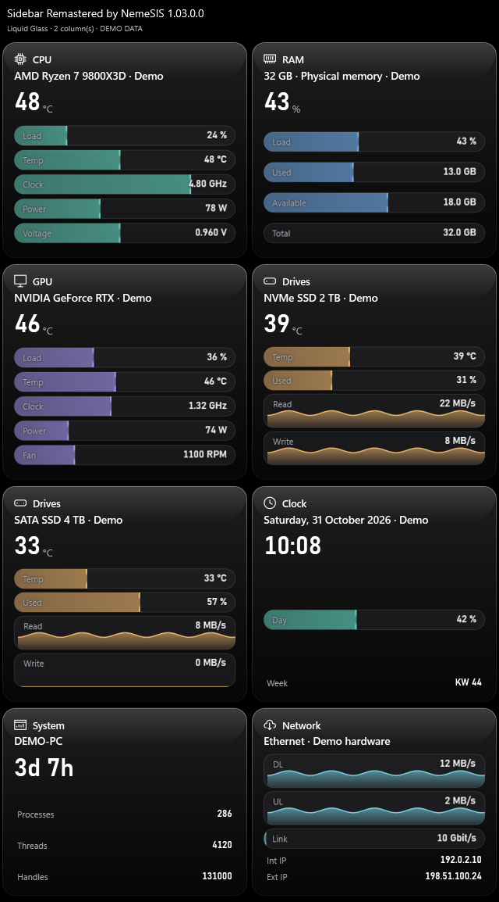</a>

All images are rendered by the app's own WPF renderer with demo hardware and simulated readings; they are not live benchmarks.

Sidebar Remastered is the glass edition of [Sidebar by NemeSIS](https://github.com/nemesis122/NewSidebar). It keeps the same sensor engine and settings, focuses on one design family, and installs side by side with the original: its own EXE, settings file (`remastered-settings.json`) and Windows startup task.

## 13 designs

Ten glass designs share one construction: a translucent slab, a rim that catches light at the top edge and a sheen across the upper third; they differ in material and in how they hold the readings. Three more take other directions: Acrylic Widgets in the style of desktop widgets, Liquid Glass 2.0 with glossy borderless capsules, and the flat Clean Dashboard.

| Design | Form | Character |
| --- | --- | --- |
| **Liquid Glass** | Capsules | Clear glass, readings inside capsules filled like liquid |
| **Frost Glass** | Capsules | Frosted white glass, brighter rim, rounder corners |
| **Aqua Glass** | Capsules | Glass tinted in each hardware's accent color |
| **Prism Glass** | Capsules | Rim refracted from the accent into a neighbouring hue |
| **Smoke Glass** | Capsules | Dark smoked glass, translucent fill with a glowing edge |
| **Glass Tubes** | Tubes | Reading row above a slim glass tube |
| **Glass Tiles** | Tiles | Two-column glass tiles that fill from the bottom |
| **Glass Columns** | Columns | An equalizer of vertical glass tubes with values beneath |
| **Glass Ring** | Ring | The main reading as a glass ring, the rest as slim tubes |
| **Glass Inline** | Inline | One dense line per reading: label, short bar, value |
| **Acrylic Widgets** | Widget | Windows-widget style: icon chip, 60-second sparkline and trend beside the number, thin bars |
| **Liquid Glass 2.0** | Capsules | More transparent glass, borderless glossy capsules, larger numbers, levels that glide |
| **Clean Dashboard** | Flat | Flat and calm: a divider under the number and hairline bars under each reading |

<table>
<tr><th>Liquid Glass</th><th>Frost Glass</th><th>Aqua Glass</th><th>Prism Glass</th><th>Smoke Glass</th></tr>
<tr><td valign="top"><a href="Previews/LiquidGlass-1Column.png">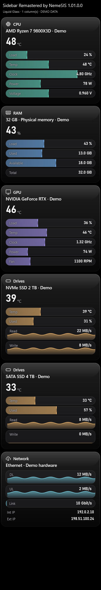</a></td><td valign="top"><a href="Previews/FrostGlass-1Column.png">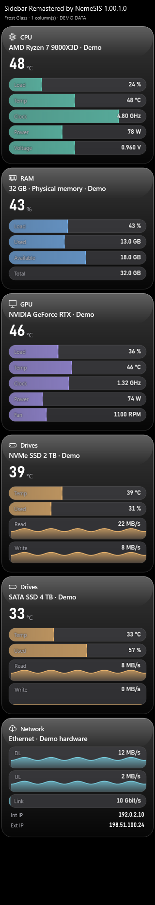</a></td><td valign="top"><a href="Previews/AquaGlass-1Column.png">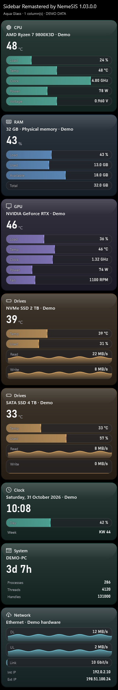</a></td><td valign="top"><a href="Previews/PrismGlass-1Column.png">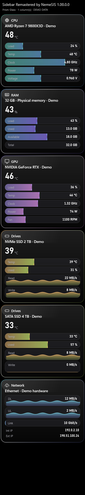</a></td><td valign="top"><a href="Previews/SmokeGlass-1Column.png">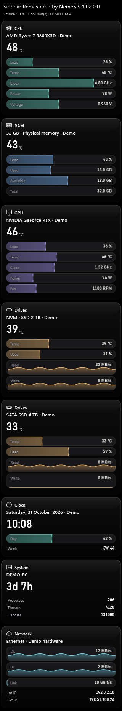</a></td></tr>
<tr><th>Glass Tubes</th><th>Glass Tiles</th><th>Glass Columns</th><th>Glass Ring</th><th>Glass Inline</th></tr>
<tr><td valign="top"><a href="Previews/GlassTubes-1Column.png">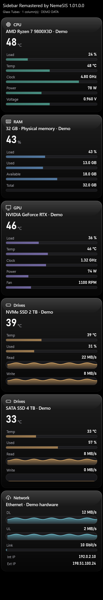</a></td><td valign="top"><a href="Previews/GlassTiles-1Column.png">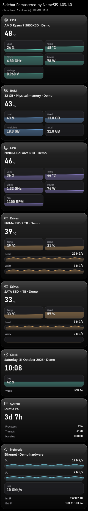</a></td><td valign="top"><a href="Previews/GlassColumns-1Column.png">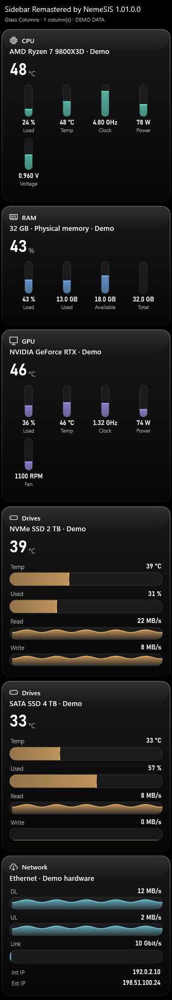</a></td><td valign="top"><a href="Previews/GlassRing-1Column.png">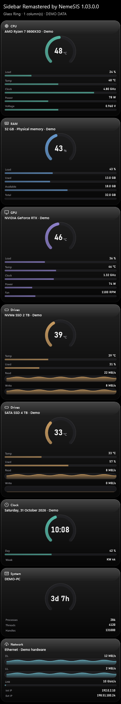</a></td><td valign="top"><a href="Previews/GlassInline-1Column.png">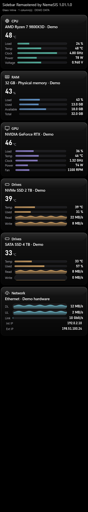</a></td></tr>
<tr><th>Acrylic Widgets</th><th>Liquid Glass 2.0</th><th>Clean Dashboard</th></tr>
<tr><td valign="top"><a href="Previews/AcrylicWidgets-1Column.png">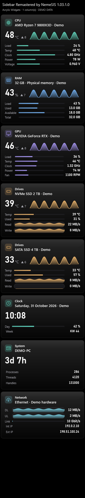</a></td><td valign="top"><a href="Previews/LiquidGlass2-1Column.png">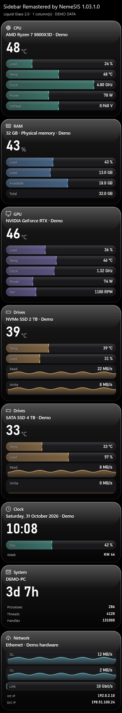</a></td><td valign="top"><a href="Previews/CleanDashboard-1Column.png">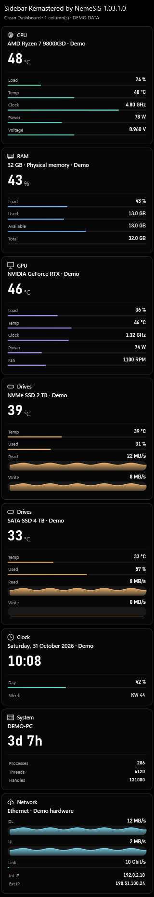</a></td></tr>
</table>

- **Temperature first:** CPU, GPU and drives show their temperature as the large number (inside the ring in Glass Ring); RAM shows its load, the clock its time.
- **Live traces:** network download/upload and drive read/write show the last 60 seconds, scaled to the last minute's peak.
- **Link use:** the link-speed bar fills with the share of the link in use right now.
- **Precise readings:** voltages with three decimals, clocks in GHz with two, memory sizes with one, link speeds like 2.5 Gbit/s.

### Two columns

<table>
<tr><th>Design</th><th>Two columns</th></tr>
<tr><td>Liquid Glass</td><td></td></tr>
<tr><td>Frost Glass</td><td><a href="Previews/FrostGlass-2Column.png">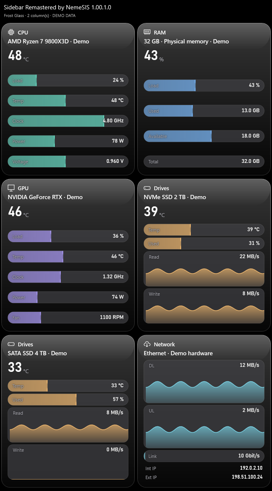</a></td></tr>
<tr><td>Aqua Glass</td><td><a href="Previews/AquaGlass-2Column.png">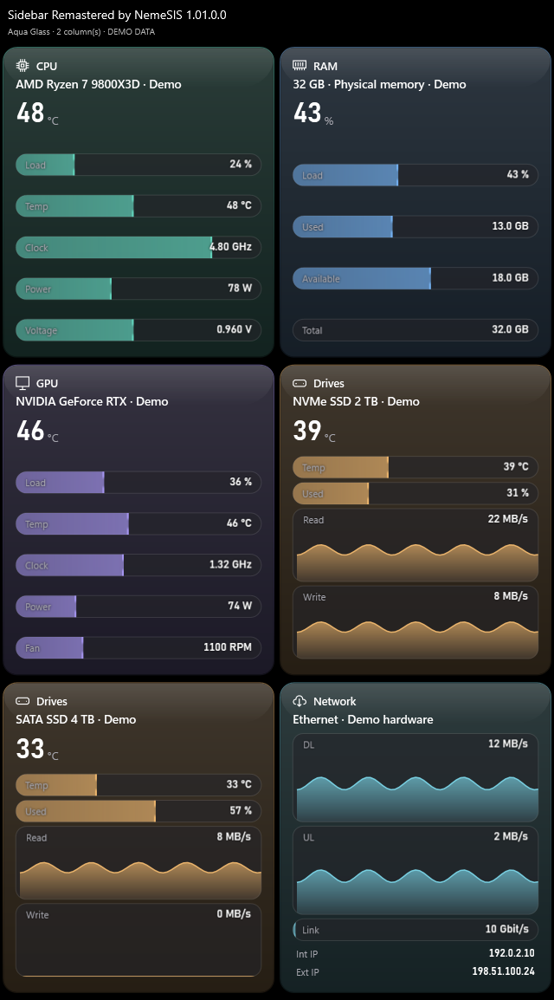</a></td></tr>
<tr><td>Prism Glass</td><td><a href="Previews/PrismGlass-2Column.png">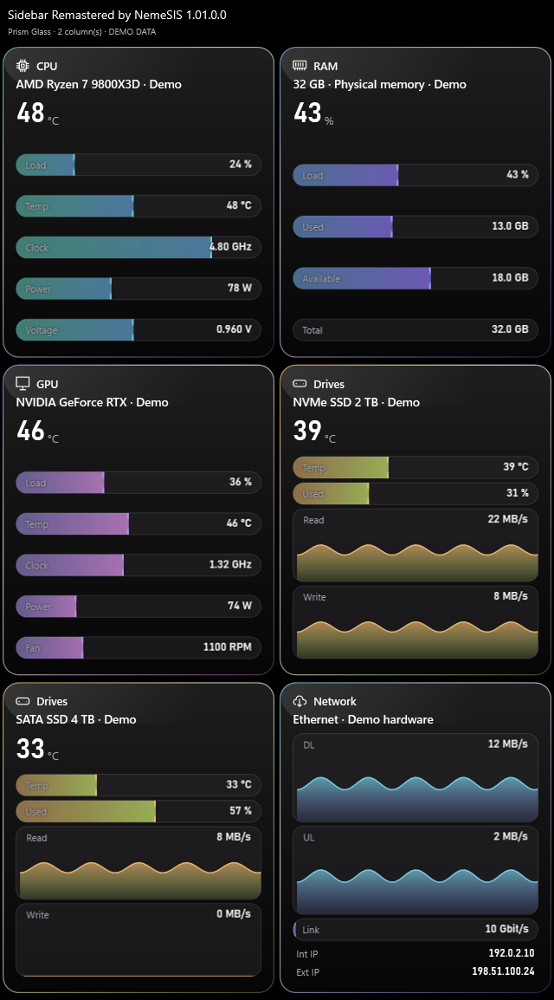</a></td></tr>
<tr><td>Smoke Glass</td><td><a href="Previews/SmokeGlass-2Column.png">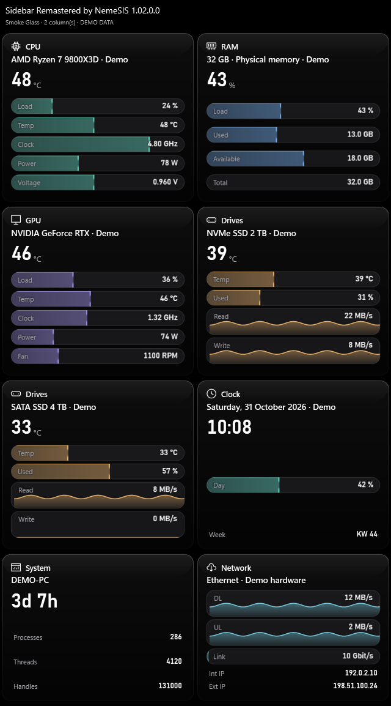</a></td></tr>
<tr><td>Glass Tubes</td><td><a href="Previews/GlassTubes-2Column.png">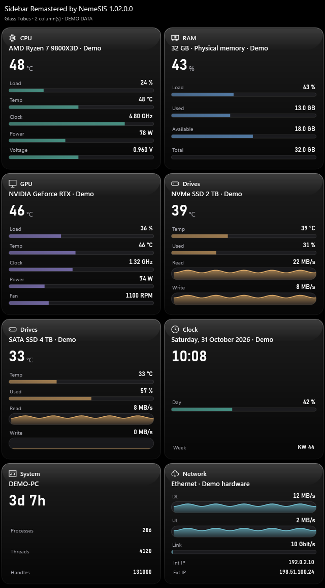</a></td></tr>
<tr><td>Glass Tiles</td><td><a href="Previews/GlassTiles-2Column.png">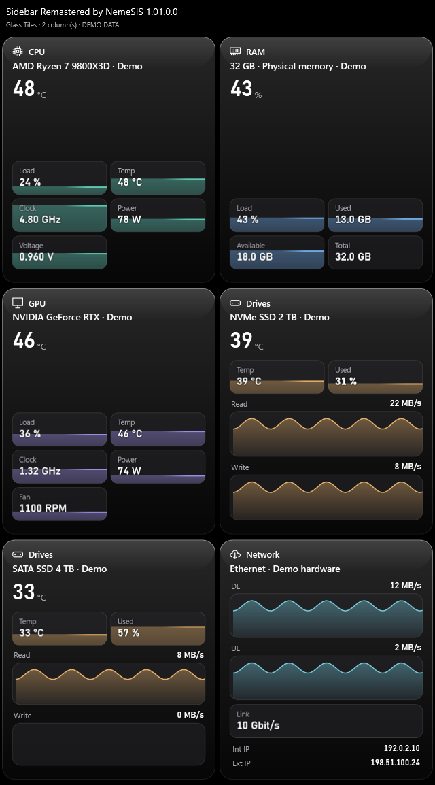</a></td></tr>
<tr><td>Glass Columns</td><td><a href="Previews/GlassColumns-2Column.png">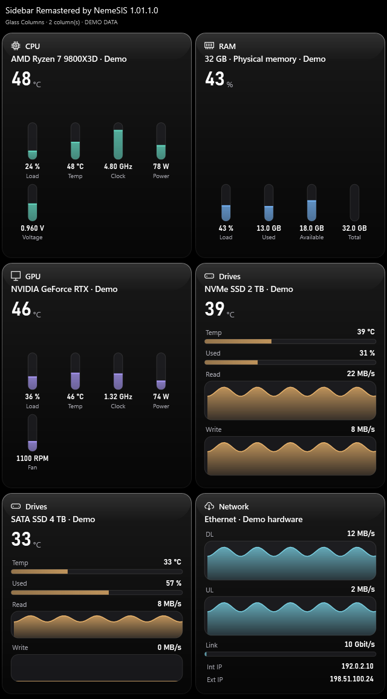</a></td></tr>
<tr><td>Glass Ring</td><td><a href="Previews/GlassRing-2Column.png">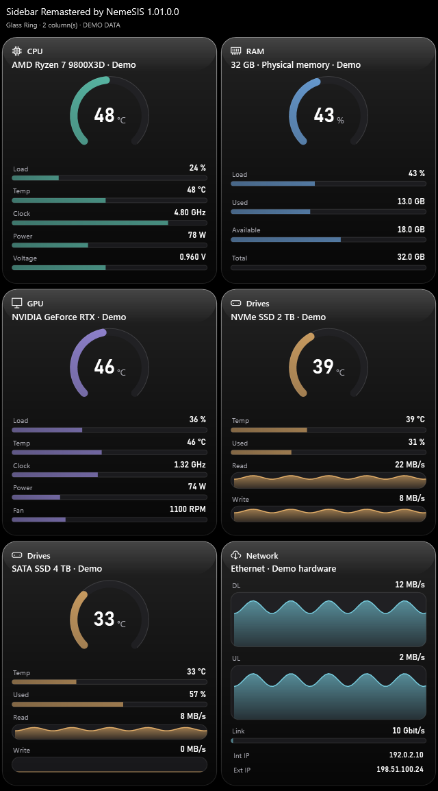</a></td></tr>
<tr><td>Glass Inline</td><td><a href="Previews/GlassInline-2Column.png">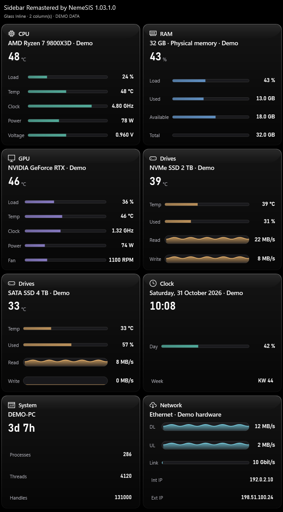</a></td></tr>
<tr><td>Acrylic Widgets</td><td><a href="Previews/AcrylicWidgets-2Column.png">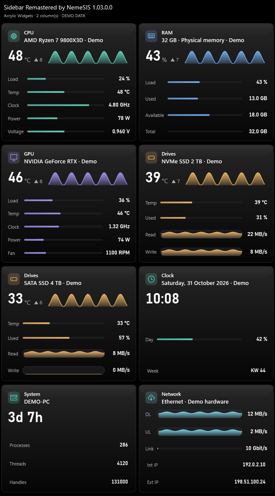</a></td></tr>
<tr><td>Liquid Glass 2.0</td><td><a href="Previews/LiquidGlass2-2Column.png">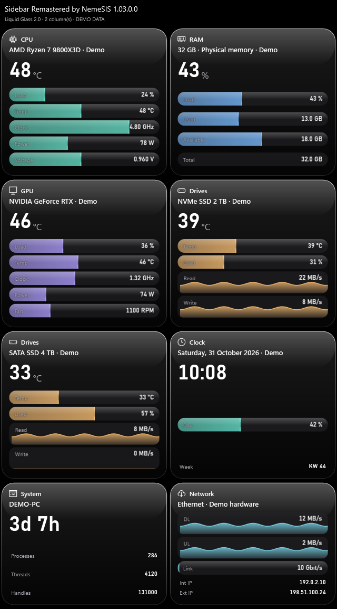</a></td></tr>
<tr><td>Clean Dashboard</td><td><a href="Previews/CleanDashboard-2Column.png">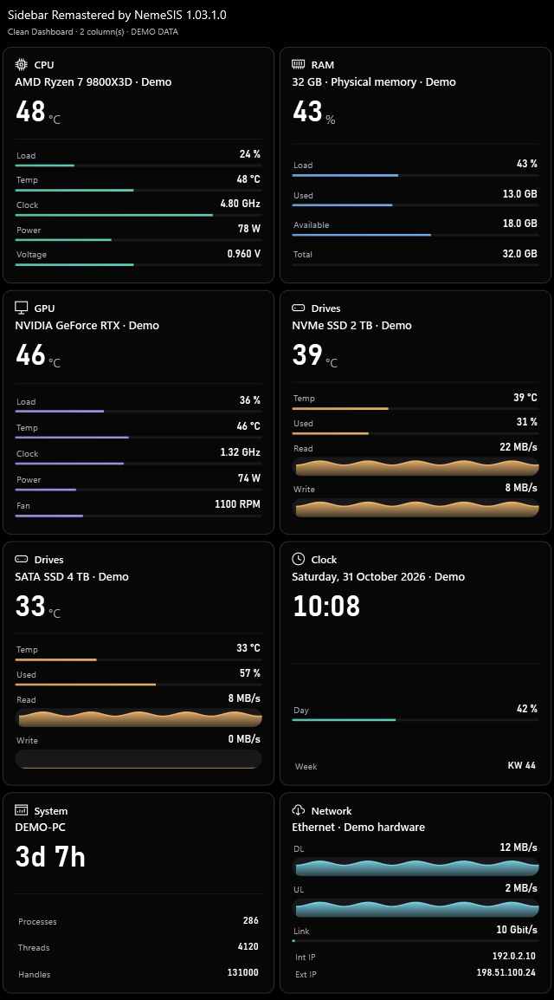</a></td></tr>
</table>

## Design per widget

Every widget can have its own design. Choose a card layout for the whole sidebar, then give single widgets their own look under **Cards & order → Design per widget**, for example the clock as a ring, the CPU as columns and the drives as inline rows. "Same as above" keeps the main layout.

<a href="Previews/Mixed-2Column.png">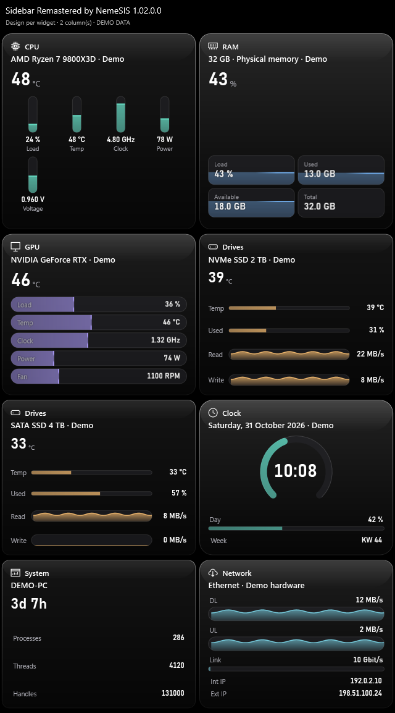</a>

## Widgets

| Widget | Shows |
| --- | --- |
| **CPU, GPU** | Temperature as the large number, load, clock, power, voltage, fan, VRAM |
| **RAM** | Load, used, available and total memory |
| **Drives** | Temperature, used space, live read/write traces |
| **Network** | Live download/upload traces, link use, optional internal/external IP |
| **Clock** | Time as the large number, the date, day progress and calendar week |
| **System** | Uptime, processes, threads and handles |
| **Battery** | Charge, charging state and remaining time (only on devices with a battery) |

Show, hide and reorder widgets under **Cards & order**; hide single readings under **Devices & readings**.

## 19 color themes

The color theme is independent of the design. Here every theme on the Liquid Glass CPU card:

<table>
<tr><td align="center" valign="top"><a href="Previews/Themes/Original.png">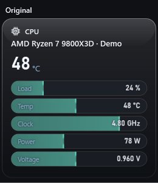</a> Original</td><td align="center" valign="top"> Midnight</td><td align="center" valign="top"><a href="Previews/Themes/Graphite.png">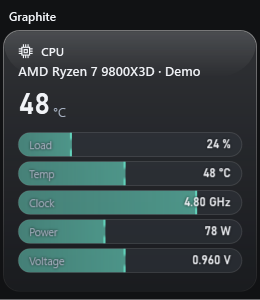</a> Graphite</td><td align="center" valign="top"><a href="Previews/Themes/OLED.png">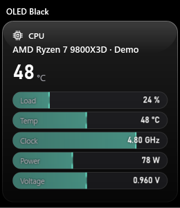</a> OLED Black</td><td align="center" valign="top"><a href="Previews/Themes/Nord.png">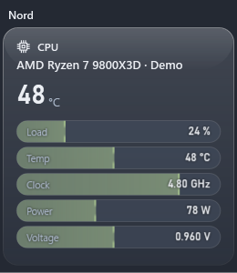</a> Nord</td></tr>
<tr><td align="center" valign="top"><a href="Previews/Themes/Dracula.png">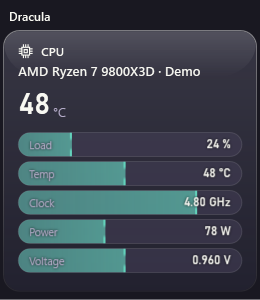</a> Dracula</td><td align="center" valign="top"><a href="Previews/Themes/Gruvbox.png">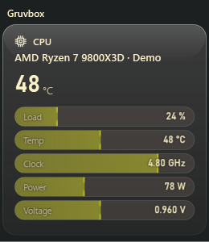</a> Gruvbox</td><td align="center" valign="top"><a href="Previews/Themes/Solarized.png">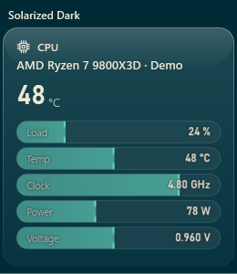</a> Solarized Dark</td><td align="center" valign="top"><a href="Previews/Themes/Terminal.png">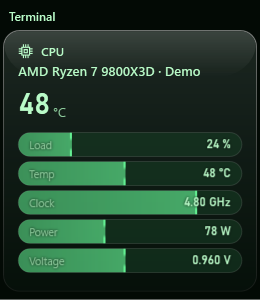</a> Terminal</td><td align="center" valign="top"><a href="Previews/Themes/Neon.png">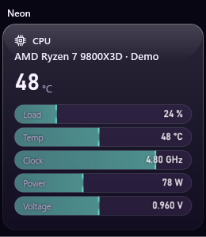</a> Neon</td></tr>
<tr><td align="center" valign="top"><a href="Previews/Themes/Compact.png">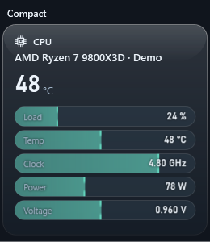</a> Compact</td><td align="center" valign="top"> Minimal</td><td align="center" valign="top"><a href="Previews/Themes/Light.png">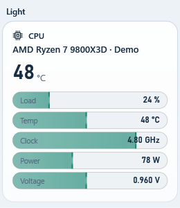</a> Light</td><td align="center" valign="top"><a href="Previews/Themes/Arctic.png">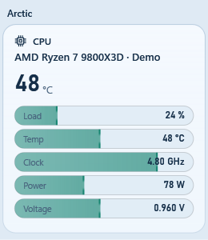</a> Arctic</td><td align="center" valign="top"><a href="Previews/Themes/Catppuccin.png">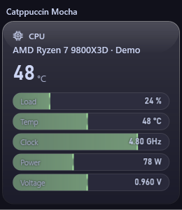</a> Catppuccin Mocha</td></tr>
<tr><td align="center" valign="top"><a href="Previews/Themes/TokyoNight.png">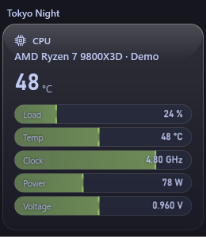</a> Tokyo Night</td><td align="center" valign="top"><a href="Previews/Themes/RosePine.png">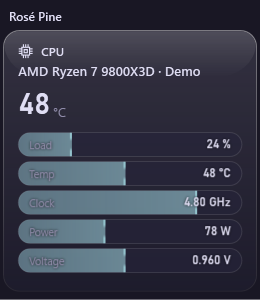</a> Rosé Pine</td><td align="center" valign="top"><a href="Previews/Themes/Kanagawa.png">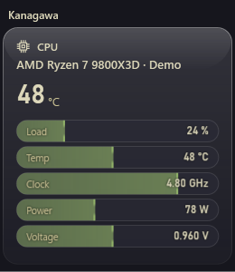</a> Kanagawa</td><td align="center" valign="top"><a href="Previews/Themes/Everforest.png">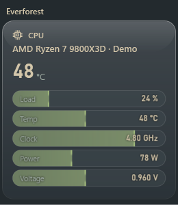</a> Everforest</td></tr>
</table>

## Make it yours

| Area | What you can change |
| --- | --- |
| Design and placement | 13 designs, a different design per widget if you like; monitor; left or right edge; column width; 1–4 columns; fit-to-view or scrolling; text below the capsules |
| Typography | Font family, general size, separate widget-title, hardware-name, label, reading, instrument-number and unit sizes; individual visibility |
| Hardware icons | Show/hide and size |
| Colors and graphics | Color theme, text/label/hardware-name/reading colors, accent color per widget, secondary color, capsule track, graphic size and line/bar thickness |
| Backgrounds | Glass opacity while the text stays fully readable |
| Content | Device visibility, selected readings, custom sensors on their matching widget, custom hardware names, card order and an optional shared HW Sensors frame |
| Sensors and operation | Sensor source, CPU temperature source, °C/°F, refresh interval, warning thresholds, startup on/off, taskbar-edge reservation and tray behavior |
| Reset | One reset button on every settings page; Overview and System reset everything except language, startup and sensor access |

Settings are available in German, English, French, Italian, Spanish and Portuguese.

## Settings

<a href="Previews/Settings-Appearance.png">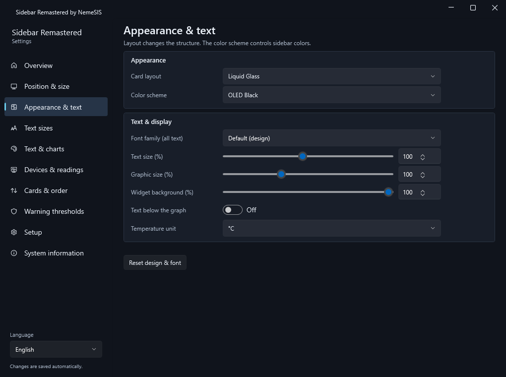</a>
<a href="Previews/Settings-TextSizes.png">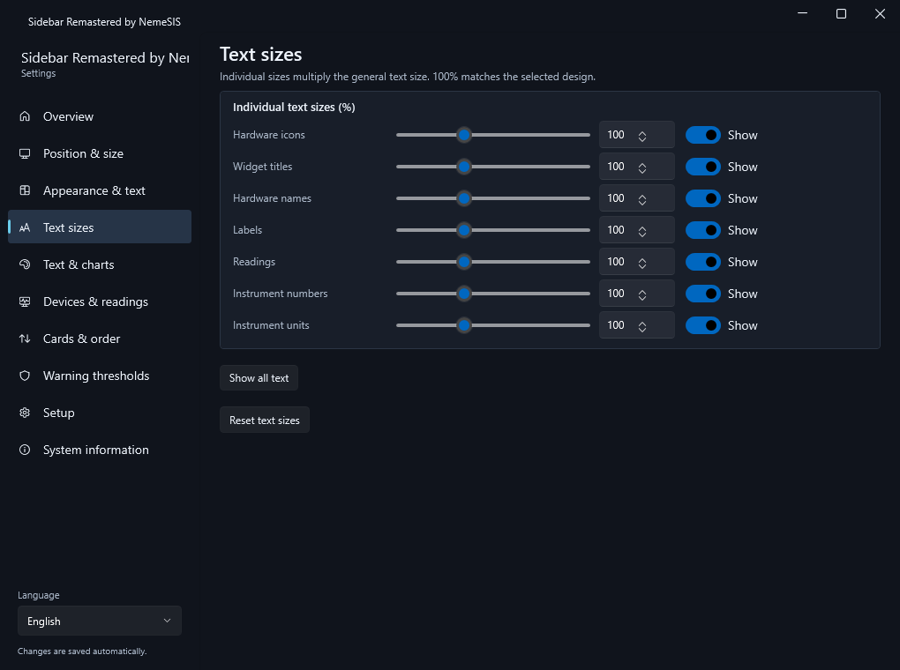</a>

## Start and update

Download the EXE into a writable folder and run it. .NET is included. Your choices are stored in `remastered-settings.json` beside the EXE; keep it there when you update. The actual EXE, settings and startup paths are shown under System information. Advanced CPU and motherboard sensors need PawnIO; Setup guides the one-time configuration, which may ask for administrator approval once. The EXE is unsigned.

## Hardware and sensor support

Hardware and available sensors are detected on the computer running the EXE. The app does not reuse fixed sensor addresses from the developer PC. It supports many AMD Ryzen/X3D and Intel CPU systems, NVIDIA/AMD/Intel GPUs, storage devices, motherboard and cooling sensors through the bundled libraries. Exact readings depend on the model, BIOS/firmware, installed vendor drivers and access rights; not every sensor is exposed on every machine.

- **LibreHardwareMonitor + PawnIO** is the default source.
- **Open Hardware Monitor + PawnIO** is a hybrid option: a modified driverless OHM component supplies supported GPU/SMART data and Libre/PawnIO bridges CPU/motherboard and missing readings. It is not an entirely independent CPU sensor engine.
- RAM, volumes and network use Windows APIs. Advanced CPU/motherboard sensors need PawnIO and appropriate access; Setup provides status and installation/configuration actions. Setup may need administrator approval once.
- Missing readings display `—`; a stopped fan or idle load can correctly be zero. First sensor samples may need initialization time.
- No WinRing0 or InpOut driver is bundled. The existing driver/resource checks are rerun for this release.

The source includes synthetic mapping tests for Ryzen 5900X, 9800X3D and 9950X3D, Intel Core i7-14700K and Core Ultra 9 285K patterns, with NVIDIA, AMD Radeon and Intel Arc GPU patterns under both sources. These are simulated mapping profiles, **not physical tests or guarantees for every listed model**. Fresh physical testing was performed only on the available Ryzen 9 5900X / RTX 3080 / ASUS X570 system. See [VALIDATION.md](VALIDATION.md) for exact evidence and limits.

## Validation and source

Every release is built by the release workflow on Windows after the data, sensor-mapping and native UI test suites pass; their results are attached to the release as VALIDATION.txt. Short live testing was limited to a Ryzen 9 5900X / RTX 3080 system. No universal hardware guarantee, reboot/sign-in test or long-duration soak is claimed.

Build with the .NET 8 SDK using `./Build-Portable.ps1`. Licensing notices are in `THIRD-PARTY-NOTICES.txt`, `Licenses/` and `OpenHardwareMonitor.Driverless/`. The images in this README are rendered on Windows by the "Render design previews" workflow and stored in `Previews/`.
